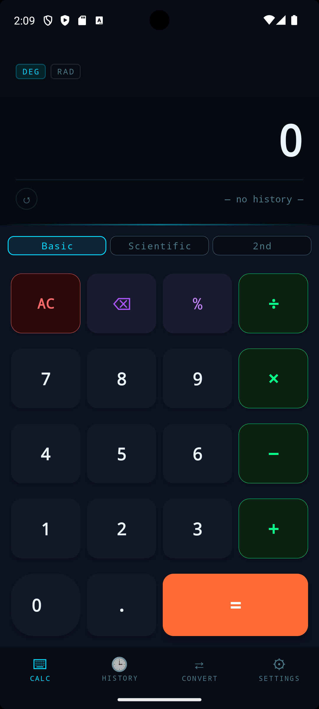
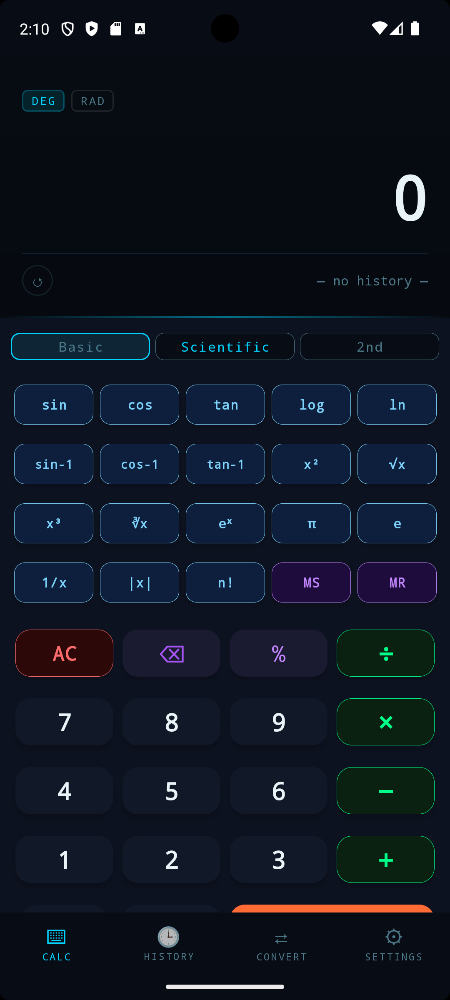

# 🧮 Modern Scientific Calculator — Android App

## 📱 App Screenshots

<p align="center">
  
  &nbsp;&nbsp;&nbsp;&nbsp;
  
</p>

## প্রজেক্ট পরিচিতি

একটি সম্পূর্ণ **আধুনিক Scientific Calculator** Android অ্যাপ।
- **Language:** Java
- **Layout:** LinearLayout + FrameLayout + TableLayout (NO ConstraintLayout)
- **Theme:** Dark cyberpunk / নিয়ন নীল থিম
- **Min SDK:** API 26 (Android 8.0+)

---

## 📂 প্রজেক্ট স্ট্রাকচার

```
ModernCalculator/
├── app/src/main/
│   ├── java/com/example/moderncalculator/
│   │   ├── MainActivity.java        ← মূল UI ও button logic
│   │   ├── CalculatorEngine.java    ← সব গণনার লজিক
│   │   ├── HistoryActivity.java     ← ইতিহাস স্ক্রিন
│   │   └── HistoryStore.java        ← Singleton history storage
│   ├── res/
│   │   ├── layout/
│   │   │   ├── activity_main.xml    ← মূল layout
│   │   │   ├── activity_history.xml ← History screen
│   │   │   └── item_history.xml     ← RecyclerView item
│   │   ├── values/
│   │   │   ├── colors.xml           ← রঙ সংজ্ঞা
│   │   │   ├── styles.xml           ← সব button style
│   │   │   └── strings.xml          ← টেক্সট
│   │   ├── drawable/
│   │   │   ├── badge_active_bg.xml
│   │   │   ├── badge_inactive_bg.xml
│   │   │   ├── glow_line.xml
│   │   │   ├── circle_border_bg.xml
│   │   │   ├── scanline_overlay.xml
│   │   │   └── history_item_bg.xml
│   │   └── anim/
│   │       ├── btn_press.xml
│   │       ├── result_pulse.xml
│   │       ├── slide_down.xml
│   │       └── slide_up.xml
│   └── AndroidManifest.xml
├── build.gradle.kts
└── settings.gradle.kts
```

---

## 🚀 Android Studio-তে Open করার নিয়ম

1. **Android Studio** খুলুন (Hedgehog বা নতুন)
2. **File → Open** → `ModernCalculator` ফোল্ডার সিলেক্ট করুন
3. **Gradle sync** হতে দিন (ইন্টারনেট লাগবে)
4. `app/src/main/res/mipmap-*` ফোল্ডারে launcher icon যোগ করুন
   অথবা Android Studio-র **Image Asset** দিয়ে তৈরি করুন:
   → Right-click `res` → New → Image Asset
5. **Run** বাটন চাপুন বা `Shift+F10`

---

## 🎨 Layout Architecture

```
LinearLayout (root, vertical)
├── FrameLayout (display)
│   ├── View (scanline overlay)
│   ├── LinearLayout (display content, vertical)
│   │   ├── LinearLayout (badge row, horizontal)
│   │   ├── TextView (expression)
│   │   ├── TextView (result)
│   │   └── LinearLayout (history row, horizontal)
│   └── View (glow line)
├── LinearLayout (button area, vertical)
│   ├── LinearLayout (mode toggle row, horizontal)
│   ├── TableLayout (scientific, 5×4)  ← hidden by default
│   └── TableLayout (main buttons, 4×5)
│       ├── TableRow × 4  [4 columns each]
│       └── TableRow      [0=span:2, ., +/-, =]
└── LinearLayout (bottom nav, horizontal)
```

---

## ✨ ফিচার তালিকা

| ফিচার | বিবরণ |
|-------|-------|
| Basic Mode | +, −, ×, ÷, %, +/−, AC, DEL |
| Scientific Mode | sin, cos, tan, log, ln, x², √, x³, ∛, eˣ, π, e, 1/x, |x|, n! |
| 2nd Mode | sin↔sin⁻¹, cos↔cos⁻¹, tan↔tan⁻¹ swap |
| DEG/RAD | Angle mode toggle |
| Memory | MS (store), MR (recall) |
| History | শেষ ৫০টি হিসাব সংরক্ষণ |
| Animation | Result pulse, button press, sci section slide |
| Haptic | বাটনে vibration feedback |
| Chain Calc | 5+3× → 8× (auto chain) |

---

## ⚠️ Icon যোগ করতে হবে

Android Studio-তে `res/mipmap-*` ফোল্ডারে default launcher icon নেই।
এটি যোগ করুন:
1. `res` ফোল্ডারে Right-click
2. **New → Image Asset**
3. Icon type: **Launcher Icons**
4. **Finish**

---

## 📦 Dependencies

```kotlin
implementation("androidx.appcompat:appcompat:1.6.1")
implementation("com.google.android.material:material:1.11.0")
implementation("androidx.recyclerview:recyclerview:1.3.2")
implementation("androidx.core:core:1.12.0")
```
# Modern-scientific-calculator
# My Project
